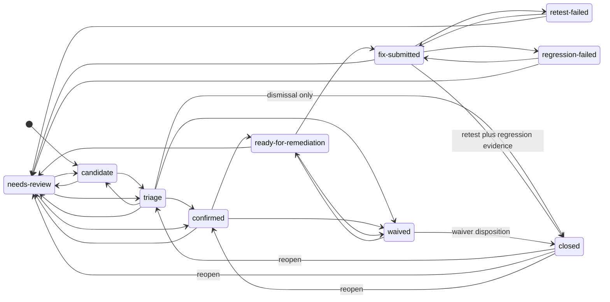

# Security finding lifecycle (Vector Sigma)

Canonical state model for **security findings** from raw signal through triage, remediation, adversarial retest, regression validation, waiver, reopen, and closure. This complements the aggressive security remediation pack: **a merged fix is not closure**, and **reopen preserves prior evidence** (new events append; do not erase history).

## Triage dispositions (VS-7)

Structured outcomes for findings in **`candidate`**, **`triage`**, or **`needs-review`**. Each disposition appends a `triageDecisions` record with mandatory **rationale** so accept/reject reasoning stays auditable.

| Disposition | Typical workflow effect | Engineering queue |
|-------------|-------------------------|-------------------|
| `confirmed` | Promotes to **`confirmed`** (via **`triage`** when starting from **`candidate`**) | Eligible for remediation routing after further promotion |
| `needs-review` | Sets **`needs-review`**; **Reviewer** owns next meaningful action | Held out of implementation-first routing |
| `duplicate` | Dismissal path to **`closed`** with `dismissalRecorded` | No |
| `false-positive` | Dismissal path to **`closed`** with `dismissalRecorded` | No |
| `informational` | Dismissal path to **`closed`** with `dismissalRecorded` | No |
| `deferred` | Workflow unchanged; rationale captures scheduling / evidence wait | Held out until re-triaged |

Ambiguity and weak-signal handling rules live in `SECURITY_TRIAGE_AMBIGUITY_RULES` (`@vs/security-orchestrator` triage module) and align with operational-rules.md (noise stays in triage; Reviewer validates before engineering).

## States

| State | Meaning |
|--------|---------|
| `candidate` | Raw or normalized signal; not yet promoted to engineering work. |
| `triage` | Structured intake: confidence, surface, redaction, duplicate/false-positive checks. |
| `confirmed` | Valid finding with credible impact/exploit path; severity owned. |
| `needs-review` | Exploitability, impact, or routing unclear; holds noise out of remediation queue. |
| `ready-for-remediation` | Confirmed and assigned; implementation is the next meaningful action. |
| `fix-submitted` | Remediation landed with recorded evidence (PR/commit notes); **not** validated yet. |
| `retest-failed` | Adversarial retest reproduced the issue or a variant; returns to fix cycle. |
| `regression-failed` | Product/regression checks failed after the fix; returns to fix cycle. |
| `waived` | Time-bound risk acceptance or duplicate/informational disposition (with rationale). |
| `closed` | Terminal disposition: closure guards satisfied (see below). |

## State diagram

## Transition rules (summary)

1. **Promotion discipline:** `candidate` does not jump to `ready-for-remediation` or `fix-submitted`. Low-confidence items stay in `triage` or `needs-review` per the quality threshold.
2. **Remediation entry:** `confirmed` → `ready-for-remediation` when the next meaningful owner is implementation; `waived` can exit to `ready-for-remediation` if a waiver is revoked or scope changes.
3. **Fix vs validation:** `fix-submitted` explicitly separates **engineering delivery** from **retest/regression proof**. Retest outcomes are recorded as transitions to `retest-failed` / `regression-failed` or as evidence supporting closure.
4. **Fix submission evidence (VS-14):** Entering `fix-submitted` from `ready-for-remediation`, `retest-failed`, or `regression-failed` requires a structured **fix submission** (code change summary, at least one commit or PR reference, and migrations/config notes) appended to the finding’s `fixSubmissions` history. The lifecycle guard uses `fixSubmissionEvidenceRecorded` in `@vs/domain` alongside orchestration helpers (`applySecurityFindingFixSubmission` in `@vs/security-orchestrator`). This is **retest-ready**, not “done.”
5. **Waiver:** `waived` supports risk acceptance (PM-owned disposition) and triage-side duplicate/informational disposition; both require **auditable rationale** before `closed` when used as a closure path from `waived`.
6. **Reopen:** From `closed`, only `triage`, `needs-review`, or `confirmed` are valid reopen targets, and only when **new or resumed evidence** is attached (exploit still works, bypass, sibling path, or missing prior evidence).

Authoritative allowed edges (including identity transitions) are implemented in `@vs/domain` (`securityFindingLifecycle.ts`) for deterministic checks in tooling and tests.

## Closure guards

A finding may enter **`closed`** only from:

| From state | Guard |
|------------|--------|
| `fix-submitted` | **Retest-complete evidence:** adversarial retest of the original path and agreed variant set is recorded as complete **and** **regression checks pass** (no `regression-failed` outstanding). Developer claim alone is insufficient. |
| `waived` | **Structured waiver disposition** (`waiverDispositions`): PM-owned rationale (minimum length enforced in schema), compensating controls, and **`followUpDueAt` strictly after `recordedAt`** for a time-bounded follow-up. Enforced by `deriveSecurityFindingWaiverClosureReadiness` / `applySecurityFindingWaiverClosure` in `@vs/security-orchestrator`. |
| `triage` | **Dismissal recorded:** duplicate, false positive, or informational non-defect with rationale. **Critical/High** additionally require **Reviewer elevated dismissal attestation** on the triage decision so these severities cannot silently dismiss without adversarial review (VS-19). |

**Not allowed:** `closed` directly from `candidate`, `confirmed`, `needs-review`, `ready-for-remediation`, `retest-failed`, or `regression-failed` without passing through an eligible from-state and guards above.

## Reopen guards

From **`closed`**, a transition to `triage`, `needs-review`, or **`confirmed`** requires:

- **Reopen evidence attached** (reproduction, bypass payload, regression capture, or gap in prior evidence), and  
- **Audit trail preserved** (prior comments, artifacts, and history remain; append new evidence).

Typical routing after reopen:

- **Exploit still valid or bypass found** → `confirmed` then `ready-for-remediation` / `fix-submitted` loop.  
- **Ambiguous signal** → `needs-review` or `triage` before re-promotion.

## Role hints (non-normative)

| Badge | Soul | Typical touchpoints |
|-------|------|----------------------|
| SH | Soundwave | `candidate` → `triage` normalization |
| RV | Starscream | `needs-review` → `confirmed`, adversarial retest from `fix-submitted` |
| LE | Shockwave | `ready-for-remediation` → `fix-submitted`, root-cause fix evidence |
| QA | Barricade | Regression evidence alongside closure from `fix-submitted` |
| PM | Optimus Prime | Severity gates, `waived`, release blocking |

## Severity escalation and release blocking (VS-19)

- **Critical:** tracker automation adds **PM** and **Lead Engineer** watchers with `autoNotify`, plus **Reviewer** while the finding is in pre-remediation workflow states (`candidate` through `ready-for-remediation`). Ticket comments call out PM + LE visibility.
- **High:** PM watcher (notify) and **Reviewer** watcher in the same pre-remediation states so severity cannot bypass stronger review.
- **High/Critical dismissals from triage:** orchestration rejects `duplicate` / `false-positive` / `informational` unless `elevatedDismissalReview` is supplied; the lifecycle domain requires matching transition context flags.
- **Waivers:** PM-owned records live in `waiverDispositions`; closure from `waived` is blocked until follow-up timing is valid.
- **Release enforcement:** `deriveReleaseSecurityBlocking` / `isSecurityFindingActiveReleaseBlocker` in `@vs/security-orchestrator` return machine-readable blockers when any finding is open **Critical** or **High**, or **waived** Critical/High **without** a structured waiver row — intended for CI / ship scripts. Suggested ticket tag: `security:release-blocked`.

## Related material

- Security architecture and auth boundary: [`security-architecture.md`](./security-architecture.md)  
- Operational incident response: [`runbooks/production-auth-data-security-incidents.md`](./runbooks/production-auth-data-security-incidents.md)
